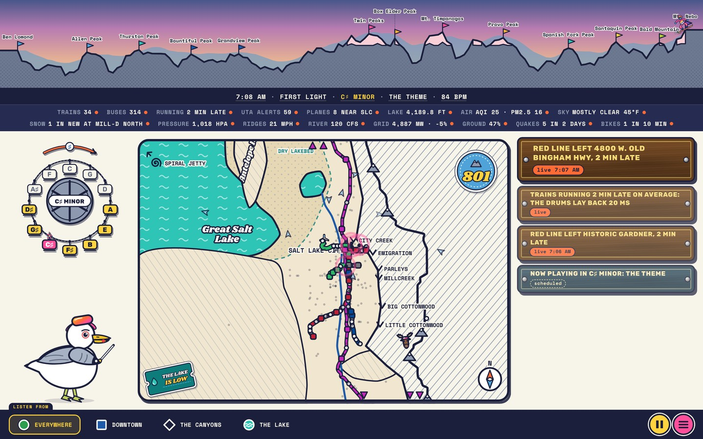

# Wasatch Symphony

A web app that plays the Salt Lake valley live as music, from its trains, buses, planes, weather, air and seismometers. A Rust engine compiled to WebAssembly composes and renders every bar on the browser's audio thread, and every phone plays the same bar at the same moment, about 90 seconds behind the valley. A small Node server seals the realtime feeds into 30-second windows that every phone reads alike. The page is TypeScript and hand-drawn SVG.

**Status: working.** The site is live; the Utah Avalanche Center's forecast is coded and tested, and stays off until its API token is set.

Live: https://ampactor.dev/wasatch/



## Quick start

Open https://ampactor.dev/wasatch/ and tap **Listen to the Wasatch**. To run
it yourself you need Rust (stable, with `rustup target add
wasm32-unknown-unknown`) and Node 24:

```sh
npm ci
npm run engine   # build the engine to web/public/engine (SIMD and scalar)
npm run gtfs     # download and compile UTA's schedule to web/public/schedule
npm run dev      # http://localhost:5173/wasatch/
```

The page reads the valley, then the button turns to *Listen to the Wasatch*.
`npm run conductor` runs the server on :8080; open the page with
`?conductor=http://localhost:8080` to use it. `?debug` adds a panel of the
engine's load, the audio's state and level, the latencies and the clock.

## How it works

[DESIGN.md](DESIGN.md) is the whole design: the music theory, the data, the
sync, and why each choice was made.

### What you hear

Tap Listen and the Wasatch theme plays on piano, the crest itself as a
melody, thirteen summits from Ben Lomond to Mount Nebo, in the key the valley
is in right now. Then the live piece fades in under it:

| What's happening in the valley | What you hear |
|---|---|
| A TRAX train leaves a station | A bell on its line's chord tone (Blue root, Red fifth, Green third) |
| FrontRunner at Salt Lake Central | A horn in the rhythm of a grade crossing, and the phrase it arrives in comes home |
| Buses everywhere | The groove's density: hats and shakers in Euclidean patterns |
| The buses and trains stuck in traffic, or flying | The tempo, a few BPM either way |
| A UTA service alert | A drum fill into the next phrase; one on the trains holds the tension up |
| A plane taking off from SLC, or coming in to land | A slow swell of brass and strings from where it is in the sky |
| The Jordan and Little Cottonwood Creek against the usual for the date | The bass: a held root when they're low, a walk when they're high, eighths in a flood |
| A ski bus heads up a canyon | Drums in that canyon's own echo |
| Great Salt Lake's level | The drone under everything; below 4,198 ft, phrases don't always come home |
| The sky over the valley | How bright the mode is, Lydian through minor |
| A storm on its way to Alta | The harmony held in suspense, a darker pad, until the snow starts |
| A hot day, a bitter one | A little warmth on the whole mix, or a glassier top |
| The grid drawing more power than usual | The whole mix swells a decibel or so |
| Wind on the ridges | An Aeolian harp, each string picked by the wind's shedding frequency |
| Snow falling in the Cottonwoods | Grains of sparkle, as light as the powder is |
| New snow overnight, and a deep snowpack | The theme played bigger (doubled on a POW DAY); ninths through the pad |
| Smog and an inversion | Haze over the pad, as the monitor nearest where you listen measures it; a low ceiling on the reverb |
| The ground under downtown | Four seismometers, moved up onto the chord |
| An earthquake in Utah | A bell, higher for a shallow one, lower and longer for a deep one |
| A GREENbike checked out, or docked | A marimba pluck, an octave higher for one leaving |

The harmony moves at every section boundary, one note at a time, and a caption
says why: *"The valley's slowing down → B♭ minor (G♭ for G)."* Pick where
you're listening from (the whole valley, the Gallivan Center downtown, Tanners
Flat up Little Cottonwood, Saltair on the lake) and you're standing there:
what's near is close, bright and dry, what's far is quiet, dark and echoing,
and the place answers with its own echoes. The mix changes; the music doesn't.

### The menu

**Play along** by tipping the phone onto its edges like a ski; it can't play
a wrong note, and only you hear it. **Add your run**: a GPX file becomes a
piano solo over the live valley, every turn a note, saved as a 30-second clip
if you like; the file never leaves your device. **Rewind**, or hear **A Day in Twelve Minutes**, any archived day as a
300-bar piece. **Line up with a friend**: on Android and desktop, *Tune to the
room* listens for the phone next to it and lines this one up. **Show
mappings** is the lowdown: every stream, what it plays, its live value, where
it came from, and a live spectrogram. A conditions board shows every reading
at once, and anything on screen that comes from the valley explains itself
when tapped. On a desktop, Space plays and pauses and 1 to 4 pick where you
listen from.

### The parts

- **The engine** ([`engine/`](engine/)) is Rust on
  [sonido](https://github.com/ampactor-labs/sonido), compiled to WebAssembly
  and run in an AudioWorklet. It plans the day, composes each bar, voices and
  renders it: a sampled piano, a pad whose waveform is the skyline's spectrum,
  modal bells and marimbas, a Karplus–Strong harp, every family staged from
  where you're listening and a modeled room per vantage, and a mastering
  chain to −16 LUFS. The same `.wasm` renders offline in Node for the tests.
- **The score** is deterministic. A day's plan is a function of the transit
  schedule, the sun and moon, and sky observations; every random choice comes
  from a counter-based generator keyed by the bar. Two phones with the same
  inputs play the same notes. Forecasts only color bars; observations steer.
- **The schedule** ([`tools/gtfs/`](tools/gtfs/)) is compiled from UTA's GTFS
  every day into small JSON files: every rail departure, ski-bus trip, and the
  bus network's activity by the minute.
- **The page** ([`web/`](web/)) is TypeScript and hand-drawn SVG: the skyline
  with a shredder riding the theme summit to summit, the valley map with every
  scheduled train, the harmony dial as a ski-lift bullwheel, and captions on
  routed-wood trail signs.
- **The conductor** ([`conductor/`](conductor/)) is a small Node server that
  reads what a browser can't (UTA's realtime and service alerts, KSLC's
  METARs, the planes over SLC, EIA's grid, the snow forecast at Alta, the air
  monitors), holds the one connection to the seismometers, and seals it all
  into 30-second windows: the bells ring when the trains actually leave, and
  a late one lays back behind the beat. If it's unreachable, the site plays
  from the schedule and the open feeds.

## Data

The browser reads USGS (the lake, the Jordan River, earthquakes), the National
Weather Service, Open-Meteo, SNOTEL, GREENbike's GBFS feed and the University
of Utah's seismometers (over EarthScope's DataLink WebSocket, decoded from
miniSEED in the page). The conductor reads UTA's GTFS-realtime and alerts,
KSLC's METARs, adsb.lol, EIA, UDOT, the Alta forecast and EPA AirNow, polling each
at its own pace and sealing a window every 30 seconds. UTA's schedule is recompiled every morning, and each
finished day's sky is sealed into the archive.

Sources and licences: Utah Transit Authority (GTFS), U.S. Geological Survey,
National Weather Service, Open-Meteo (CC BY 4.0) with Copernicus CAMS, USDA
NRCS SNOTEL, BCycle/GREENbike (GBFS), the University of Utah Seismograph
Stations via EarthScope, adsb.lol (ODbL), the U.S. Energy Information
Administration, and EPA AirNow with the Utah Department of Environmental
Quality (air quality observations that are preliminary and not yet
validated). The crest is from USGS 3DEP elevations.

## Project layout

```
engine/          the Rust engine (plan, compose, voicing, audio, FFI)
web/             the page: src/engine (worklet host), src/app, src/art, src/data
conductor/       the optional server: realtime trains, planes, alerts, roads, sealed windows, a clock
tools/gtfs/      UTA GTFS → the score's schedule files (and the archive)
tools/archive/   sealing each finished day's sky
tools/render/    offline renders and the quality check
tools/e2e/       the headless browser test
research/, docs/  the measurements behind DESIGN.md; the first design and the screenshot
```

## Deploy

The site is GitHub Pages. Every push to `main`, and a build each morning at
09:17 UTC before the trains start, compiles the engine and UTA's schedule and
publishes. The conductor runs on Railway from the repository's `Dockerfile`;
a push to `main` that touches `conductor/**`, `web/src/data/**`,
`web/src/engine/protocol.ts`, `Dockerfile` or `package.json` redeploys it
once CI passes. [conductor/README.md](conductor/README.md) covers its API
keys and `npm run keys:check`; `/health` reports the running commit and each
key's state.

## Testing

```sh
cd engine && cargo fmt --check && cargo clippy --release --all-targets -- -D warnings && cargo test --release && cd ..
npm run typecheck
npm run engine && npm run gtfs
npm test                                  # vitest, and the conductor's and tools' node tests
node tools/theme/build.ts --check         # the crest drawing and the engine's theme match the measured profile
node tools/render/check.ts --seconds 75   # loudness, true peak, silence, determinism, a day in twelve minutes
npx vite build --config web/vite.config.ts && node tools/e2e/smoke.ts --seconds 20
```

`render/check.ts` renders the same `.wasm` the page uses. `smoke.ts` drives
headless Chrome (`CHROME_PATH` if it isn't in a standard place) against
`dist/`: the phone view holds its audio until the tap, as a phone does, both
views fail on silence, and it walks every menu feature. CI runs all of it.

## Limitations

Automated tests run only in headless Chrome, so Safari and real phones are checked by hand. On October 29, 2026 that let phones play silence while every check passed, because headless Chrome starts its audio at page load and a phone waits for the tap. The smoke test now holds the audio until the tap and fails on silence.

- **About 90 seconds behind,** so that every phone plays the same window.
- **Stand-ins.** Planes come from adsb.lol's community receivers; a receiver
  of our own isn't built. The FrontRunner horn, the strings and the brass are
  synthesized; only the piano is sampled.
- **Waiting on keys.** The avalanche forecast is tested against its
  documentation only, and stays off until its token is set. UDOT's message
  signs have given no travel time the parser recognizes yet. UTA's SIRI API
  is coded and probed, with no token yet.
- **iPhones line up by ear.** *Tune to the room* needs the microphone, which
  on iOS drops Web Audio to call volume.
- **Slow phones drop out.** On an Android phone over Bluetooth, `?debug`
  showed the engine at about 15% of a core, with some render blocks running
  late and two audio dropouts.

## Roadmap

- The avalanche forecast, when its token arrives, and UDOT's signs read live.
- A recorded FrontRunner horn, once the recording exists.
- An ADS-B receiver of our own, to stop leaning on adsb.lol.

## License

GNU Affero General Public License v3.0 or later. See [LICENSE](LICENSE). The
piano is the Salamander Grand Piano by Alexander Holm (CC BY 3.0). The type is
Shrikhand, Rubik and Space Mono (SIL Open Font License).
